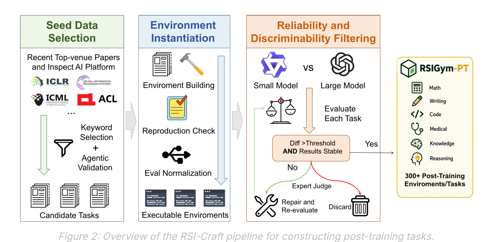
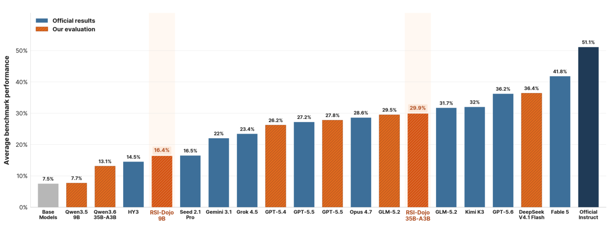
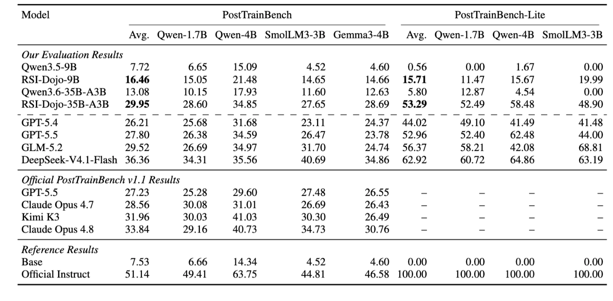

# RSI-Dojo

Training LLM Agents to Automate LLM Post-Training.

RSI-Dojo is an open-source collection of executable environments for studying
LLM agents that automate LLM post-training. Each environment is designed to let
an agent analyze a target benchmark, prepare or construct training data, launch
post-training runs, evaluate checkpoints, diagnose failures, and iterate toward
an improved model.

## Overview

The project is intended to support research on autonomous model-improvement
agents and recursive self-improvement workflows. Instead of only evaluating
whether an agent can solve a static task, RSI-Dojo focuses on whether an agent
can run the model-development loop itself: data selection, training, validation,
and revision.

RSI-Dojo turns post-training into executable long-horizon environments. In each
environment, an agent is given a base model, a target evaluation, and a local
workspace. The agent must inspect failures, identify useful training data,
configure post-training, run evaluations, and decide how to continue. This makes
the environment suitable for collecting and evaluating full model-improvement
trajectories rather than isolated final answers.



RSI-Craft builds the environment collection in three stages. It first searches
recent top-venue papers and InspectAI tasks for candidate benchmarks, then
instantiates executable environments by recovering data, metrics, dependencies,
and evaluation code. Finally, it filters the environments for reliability and
discriminability so that retained tasks provide useful feedback for iterative
post-training.

The full RSI-Dojo release is organized around:

- Executable post-training environments.
- Normalized benchmark interfaces and evaluation entry points.
- Dataset and paper provenance for the environments.
- Utilities for running, validating, and reproducing the environments.

The released environment source list is available in
[ENVIRONMENTS_SOURCE.md](ENVIRONMENTS_SOURCE.md). It groups the 281 normalized environments
by domain, records each environment's originating paper, public dataset, or
InspectAI task source, and summarizes the runtime dependencies used by
`run1.sh`. Some environments use an LLM judge and require
`EVAL_OPENAI_AK` and `EVAL_OPENAI_ENDPOINT` to be configured before running.

The packaged environment archive is hosted on
[Figshare](https://figshare.com/s/8f82a1c7669ee44c1a4a).

## Rolling Out Data with AutoTrainess

RSI-Dojo environments can be used as AutoTrainess-style post-training tasks.
Each rollout asks an agent to improve a base model through the same closed-loop
workflow used by AutoTrainess: plan an iteration, build or select training
data, train, evaluate, diagnose failures, and log the result.

1. Download and unpack the environment archive.

```bash
mkdir -p src/eval/tasks
tar -xJf rsi-dojo-environments.tar.xz -C src/eval/tasks
```

The archive extracts to `src/eval/tasks/rsi-dojo/`. Task slugs are listed in
[ENVIRONMENTS_SOURCE.md](ENVIRONMENTS_SOURCE.md).

2. Install the runtime dependencies.

```bash
python -m pip install -r requirements.txt
```

3. Configure LLM judge access for environments that need judge-based scoring.

```bash
export EVAL_OPENAI_AK=...
export EVAL_OPENAI_ENDPOINT=...
```

4. Add the AutoTrainess agent interface to the rollout workspace.

Use the AutoTrainess `AGENTS.md` and `autotrainhub` skills as the agent-facing
interface. The expected iteration pattern is:

```text
iteration_plan -> data -> train -> eval -> log
```

5. Launch a rollout on one RSI-Dojo environment.

```bash
bash run1.sh \
  --task rsi-dojo/<task_slug> \
  --agent local_codex \
  --model Qwen/Qwen3-1.7B-Base \
  --hours 10 \
  --output-dir results/rsi_dojo/<task_slug>/<run_id>
```

The rollout directory contains the agent trace, generated training data,
training logs, final model artifact, evaluation outputs, and iteration records.
These rollout trajectories are the data release target; they are separate from
the environment archive and are not included in the current release.

## Results Snapshot





Fine-tuning on RSI-Dojo trajectories improves both evaluated model families on
PostTrainBench and PostTrainBench-Lite. RSI-Dojo-35B-A3B reaches 29.95 on
PostTrainBench and 53.29 on PostTrainBench-Lite under the reported evaluation
setting. It also completed all 28 PostTrainBench settings and improved the
trained model in 26 of them. Across 175 total iterations, 61 iterations produced
effective improvements.

## Release Progress

- [x] Environments
- [ ] Data
- [ ] Models and code

The materials are being organized for staged release. Items will be checked off
as they become available.
