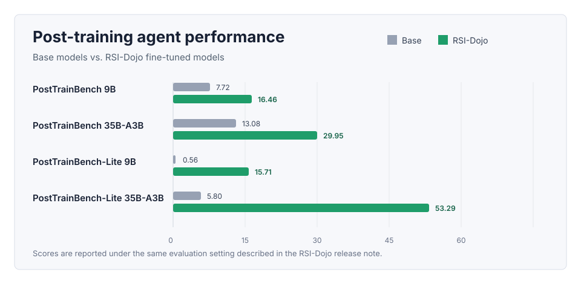

# RSI-Dojo

Training LLM Agents to Automate LLM Post-Training.

RSI-Dojo is an open-source collection of executable environments for studying
LLM agents that automate LLM post-training. Each environment is designed to let
an agent analyze a target benchmark, prepare or construct training data, launch
post-training runs, evaluate checkpoints, diagnose failures, and iterate toward
an improved model.

## Overview

The project is intended to support research on autonomous model-improvement
agents and recursive self-improvement workflows. Instead of only evaluating
whether an agent can solve a static task, RSI-Dojo focuses on whether an agent
can run the model-development loop itself: data selection, training, validation,
and revision.

RSI-Dojo turns post-training into executable long-horizon environments. In each
environment, an agent is given a base model, a target evaluation, and a local
workspace. The agent must inspect failures, identify useful training data,
configure post-training, run evaluations, and decide how to continue. This makes
the environment suitable for collecting and evaluating full model-improvement
trajectories rather than isolated final answers.

The full RSI-Dojo release is organized around:

- Executable post-training environments.
- Normalized benchmark interfaces and evaluation entry points.
- Dataset and paper provenance for the environments.
- Utilities for running, validating, and reproducing the environments.

## Results Snapshot

| Model | Benchmark | Base | RSI-Dojo | Gain |
|---|---:|---:|---:|---:|
| RSI-Dojo-9B | PostTrainBench | 7.72 | 16.46 | +8.74 |
| RSI-Dojo-35B-A3B | PostTrainBench | 13.08 | 29.95 | +16.87 |
| RSI-Dojo-9B | PostTrainBench-Lite | 0.56 | 15.71 | +15.15 |
| RSI-Dojo-35B-A3B | PostTrainBench-Lite | 5.80 | 53.29 | +47.49 |

RSI-Dojo-35B-A3B completed all 28 PostTrainBench settings and improved the
trained model in 26 of them. Across 175 total iterations, 61 iterations produced
effective improvements.

## Release Progress

- [ ] Environments
- [ ] Data
- [ ] Models and code

The materials are being organized for staged release. Items will be checked off
as they become available.
